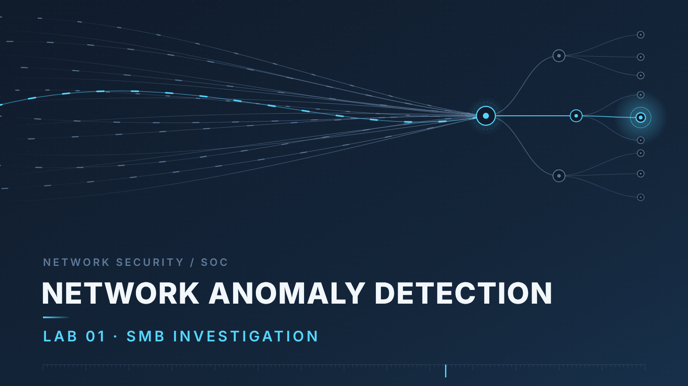

# Network Anomaly Detection Lab

<p align="center">
  
</p>

<h1 align="center">Network Anomaly Detection Lab</h1>

<p align="center">
  <strong>Network Security · Traffic Analysis · Anomaly Detection</strong><br>
  Educational cybersecurity investigations using Python and machine learning
</p>

<p align="center">
  
  
  
  
</p>

---

## Overview

This repository contains practical cybersecurity investigations focused on network traffic analysis, suspicious communication patterns, and anomaly detection.

The project uses Python, packet and log analysis, statistical features, and unsupervised machine learning to investigate potentially malicious network behavior.

The objective is to document a reproducible investigation workflow, explain the evidence, and distinguish suspicious activity from confirmed malicious behavior.

## Labs

### Lab I — SMB Scanning Investigation

**Objective:** Investigate suspicious traffic targeting TCP port 445 (SMB) and identify hosts exhibiting behavior consistent with automated scanning.

**Techniques:**
- PCAPNG inspection and packet analysis
- TCP SYN traffic analysis
- Per-source traffic feature extraction
- Isolation Forest anomaly detection
- Evidence-based investigation

**Key findings:**

| Metric | Result |
|---|---:|
| Packets analyzed | 206,536 |
| Source IPs analyzed | 79 |
| IPs classified as anomalous | 8 |
| SYN packets targeting TCP/445 | 1,912 |
| Distinct destination IPs targeted by the suspected source | 269 |

**Primary finding:** `172.19.15.200` generated a pattern of connection attempts consistent with automated SMB scanning.

These findings do not independently establish successful exploitation, malware infection, or the identity of an initially compromised host.

**Notebook:** [`notebooks/Worm_445_Analise.ipynb`](notebooks/Worm_445_Analise.ipynb)

**Report:** [`reports/RELATORIO_LAB1.md`](reports/RELATORIO_LAB1.md)

### Lab II — ICMP Traffic and Possible Data Exfiltration

**Objective:** Analyze FortiGate traffic logs to identify unusual ICMP communication patterns that may warrant investigation for possible data transfer or tunneling.

**Techniques:**
- Log parsing and normalization with Pandas
- ICMP session aggregation
- Traffic volume and duration analysis
- Source/destination pair investigation
- Isolation Forest anomaly detection
- Evidence-based interpretation of firewall counters

**Key findings:**

| Metric | Result |
|---|---:|
| Log records processed | 165,337 |
| Consolidated sessions analyzed | 51,402 |
| Sessions classified as anomalous | 391 |
| Suspicious source | `172.19.15.6` |
| Destination investigated | `192.168.15.8` |

The investigation identified high-volume ICMP sessions between `172.19.15.6` and `192.168.15.8`, including sessions with reported sent-byte counters in the tens of megabytes.

This pattern is compatible with unusual ICMP data transfer and warrants further investigation. However, firewall log counters alone do not prove that data exfiltration or ICMP tunneling occurred. The anomaly model identifies statistical outliers, not confirmed security incidents.

**Notebook:** [`notebooks/Lab_II_ICMP_Exfiltration.ipynb`](notebooks/Lab_II_ICMP_Exfiltration.ipynb)

**Report:** [`reports/RELATORIO_LAB2_ICMP_EXFILTRATION.md`](reports/RELATORIO_LAB2_ICMP_EXFILTRATION.md)

---

## Technologies

- **Python 3.11** — analysis and automation
- **Scapy** — packet inspection and network traffic analysis
- **Pandas** — data processing and aggregation
- **Scikit-learn** — unsupervised anomaly detection
- **Jupyter Notebook** — interactive investigation and documentation
- **Matplotlib** — data visualization

## Repository structure

```text
network-anomaly-detection-lab/
├── assets/                 # Project banner and visualizations
├── data/                   # Local datasets; excluded from Git
├── notebooks/
│   ├── Worm_445_Analise.ipynb
│   └── Lab_II_ICMP_Exfiltration.ipynb
├── reports/
│   ├── RELATORIO_LAB1.md
│   └── RELATORIO_LAB2_ICMP_EXFILTRATION.md
├── src/                    # Reusable analysis code
├── .gitignore
├── README.md
└── requirements.txt
```

Raw datasets are intentionally excluded from version control. Access to the original datasets may be required to reproduce the complete analyses.

## Reproducing the analysis

### 1. Requirements

- Python 3.11
- Git
- Jupyter Notebook support
- Access to the relevant datasets, obtained and used in accordance with their applicable permissions

### 2. Clone the repository

```bash
git clone <repository-url>
cd network-anomaly-detection-lab
```

Replace `<repository-url>` with the URL of the published repository.

### 3. Create and activate a virtual environment

**Windows PowerShell:**

```powershell
py -3.11 -m venv .venv
.\.venv\Scripts\Activate.ps1
```

**Linux/macOS:**

```bash
python3.11 -m venv .venv
source .venv/bin/activate
```

### 4. Install dependencies

```bash
python -m pip install --upgrade pip
pip install -r requirements.txt
```

### 5. Launch Jupyter

```bash
jupyter notebook
```

Open the relevant notebook from the `notebooks/` directory.

Place the required datasets in their expected local paths before running the analysis. Raw datasets are not included in this repository.

## Methodology and limitations

- Results depend on the available capture or logs, their completeness, and the visibility provided by the collection point.
- Anomaly detection identifies unusual patterns relative to the analyzed dataset; it does not independently determine malicious intent.
- Isolation Forest results depend on feature engineering, preprocessing, and model configuration.
- Firewall byte counters are not necessarily equivalent to unique application payload bytes.
- Suspicious traffic patterns require corroboration using packet captures, endpoint telemetry, infrastructure context, and other relevant evidence.
- IP addresses are interpreted in the context of the analyzed datasets and should not be treated as proof of attribution.

## Data source and attribution

The Lab I packet capture and original educational lab were obtained from:

Carlos Silva — https://github.com/carlossilva-cybersec/hackone_pos

Scapy, Pandas, Scikit-learn, and the other tools are used for independent analysis.

This repository is an independent educational project and is not an official publication by the original lab author. Check the source repository's license and applicable permissions before redistributing the original materials.

## Disclaimer

For educational and defensive cybersecurity purposes only. Perform network analysis only on data and systems you are authorized to investigate.
