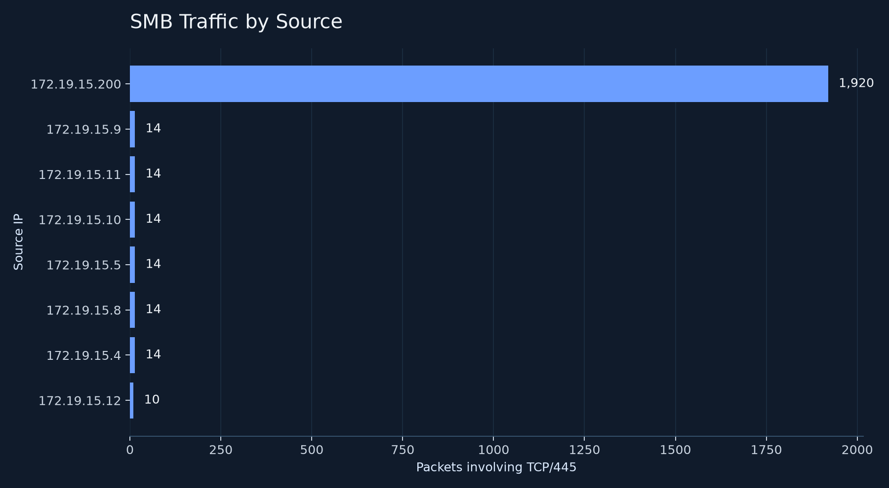
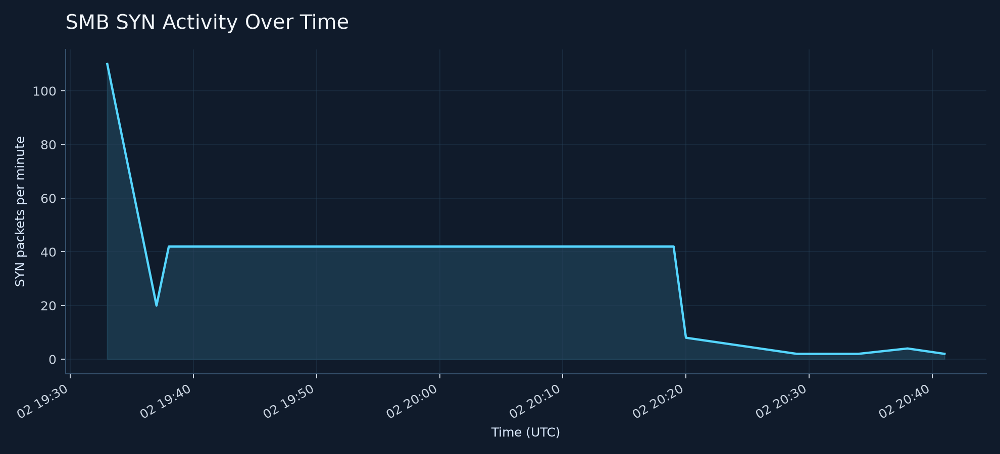
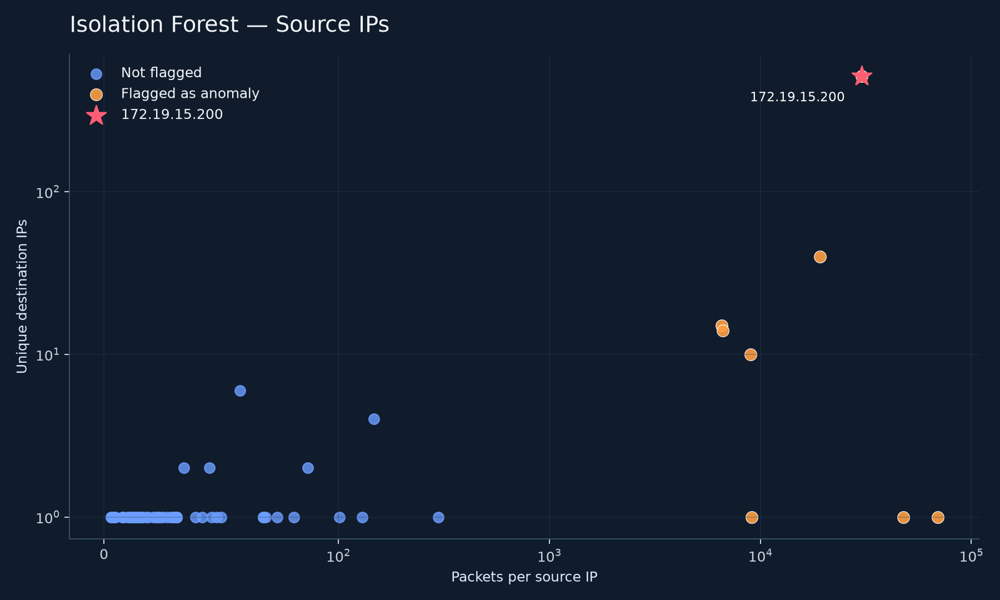



  

<h1 align="center">Network Anomaly Detection Lab</h1>

  <strong>LAB 01 · SMB Scanning Investigation</strong> 
  Network Security · Traffic Analysis · Anomaly Detection

  
  
  
  

---

## Investigation Overview

An educational cybersecurity investigation focused on suspicious network traffic targeting TCP port 445 (SMB).

The analysis combines packet inspection, per-source traffic features, statistical deviation analysis, and Isolation Forest anomaly detection to identify behavior consistent with automated SMB scanning.

## Key Metrics

| Metric | Result |
|:--|--:|
| Packets analyzed | **206,536** |
| Source IPs analyzed | **79** |
| IPs flagged as anomalous | **8** |
| SYN packets targeting TCP/445 | **1,912** |

## Primary Finding

**Suspected SMB scanning activity — `172.19.15.200`**

The host generated **1,912 observed SYN packets** destined for TCP port 445, targeting **269 distinct destination IP addresses** in the analyzed capture.

This behavior is consistent with automated SMB scanning. The available evidence does not establish successful exploitation, malware infection, or the identity of an initially compromised host.

---

## Visualizations

### 1. SMB traffic by source IP

Distribution of packets involving TCP port 445 by source IP address.

### 2. Timeline of SMB connection attempts

Timeline of SYN packets directed to TCP port 445, illustrating the observed connection-attempt pattern.

### 3. Isolation Forest anomaly detection

Visualization of the IP addresses evaluated by the anomaly detection model. Anomaly classifications are exploratory and should be interpreted alongside packet-level evidence.

---

## Reproducing the analysis

## Data source and credits

The lab and original packet capture were obtained from:

Carlos Silva — https://github.com/carlossilva-cybersec/hackone_pos

Scapy, Pandas, and Scikit-learn are used as analysis tools.

This repository documents independent educational analysis. It is
not an official publication by the original lab author. Please check
the source repository's license and applicable permissions before
redistributing its materials or packet capture.

## Limitations

- Results depend on the available packet capture and its visibility.
- Anomaly detection identifies unusual behavior; it does not establish
  malicious intent on its own.
- Scanning activity does not prove successful compromise.
- IP addresses are interpreted in the context of this capture.

## Disclaimer

For educational and defensive cybersecurity purposes only.
