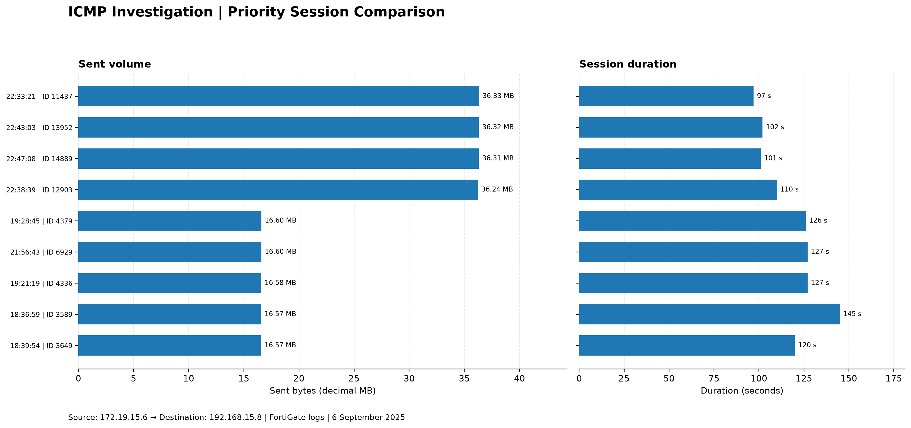
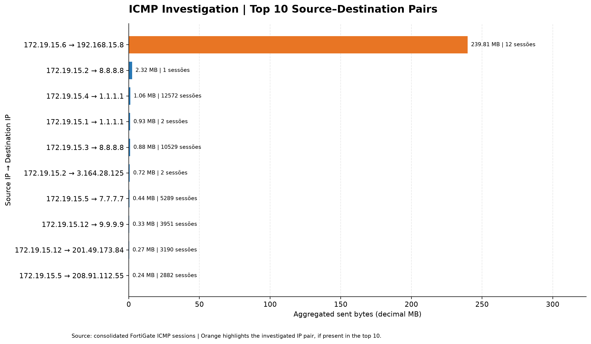
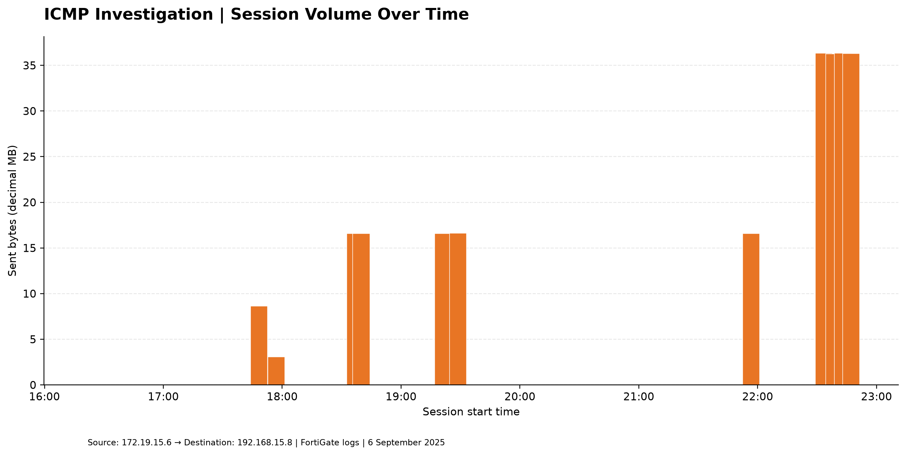

# Relatório Técnico — Lab II: Análise de Possível Tunelamento ICMP

## 1. Objetivo

Analisar logs de tráfego do FortiGate para identificar padrões ICMP
incomuns compatíveis com possível tunelamento ou transferência não usual
de dados, e avaliar o uso do Isolation Forest como método complementar
de detecção de anomalias.

## 2. Dados e metodologia

- **Fonte:** `data/fortigate_syslog.log`
- **Período dos eventos destacados:** 6 de setembro de 2025
- **Registros analisados:** 165.337 linhas, com 123 campos identificados
- **Registros com protocolo ICMP aceitos:** 51.939
- **Sessões consolidadas para a análise inicial:** 51.402
- **Ferramentas:** Python, Pandas e Scikit-learn
- **Modelo exploratório:** Isolation Forest, com `contamination=0.01` e
  `random_state=42`

O arquivo `ICMP_Data_exfiltration.log.gz` foi comparado ao arquivo de
log descompactado. Ambos continham 165.337 linhas idênticas após a
descompressão e apresentaram o mesmo SHA-256
(`4e6b0b0ebde63a2ab5f51c062fe45fa329b535579c3338aefa21cf6072fb0b3c`).
Para evitar duplicação, a análise utilizou apenas o arquivo
descompactado.

Os registros foram interpretados a partir dos campos de protocolo, ação,
origem, destino, duração, bytes, pacotes, identificador ICMP e `logid`.
A consolidação de sessões foi utilizada para triagem, mas deve ser
tratada como uma aproximação, pois os logs podem conter atualizações
cumulativas.

## 3. Visão geral dos logs

Foram identificados 165.337 registros:

| Tipo      |  Quantidade |
|:----------|------------:|
| `traffic` |     131.726 |
| `utm`     |      33.289 |
| `event`   |         296 |
| `Local`   |          25 |
| Sem valor |           1 |
| **Total** | **165.337** |

O protocolo IP 1 foi associado ao tráfego ICMP. Entre os serviços mais
frequentes estavam `PING` (131.169 registros) e `icmp/0/8` (2.032
registros).

## 4. Principal achado

O padrão mais relevante ocorreu entre:

- **Origem investigada:** `172.19.15.6`
- **Destino:** `192.168.15.8`
- **Data:** 6 de setembro de 2025

Nove sessões apresentaram volumes elevados de tráfego enviado:

| Session ID | Horário do registro final |  Bytes enviados | Volume (MB decimais) | Duração (s) | Identificador ICMP |
|-----------:|:-------------------------:|----------------:|---------------------:|-------------|-------------------:|
|     11.437 |         22:33:21          |      36.334.761 |                36,33 | 97          |              5.684 |
|     13.952 |         22:43:03          |      36.315.345 |                36,32 | 102         |              7.196 |
|     14.889 |         22:47:08          |      36.309.794 |                36,31 | 101         |              3.684 |
|     12.903 |         22:38:39          |      36.241.079 |                36,24 | 110         |              8.568 |
|      4.379 |         19:28:45          |      16.596.948 |                16,60 | 126         |              8.684 |
|      6.929 |         21:56:43          |      16.595.289 |                16,60 | 127         |              7.640 |
|      4.336 |         19:21:19          |      16.577.191 |                16,58 | 127         |              6.164 |
|      3.589 |         18:36:59          |      16.572.509 |                16,57 | 145         |              6.776 |
|      3.649 |         18:39:54          |      16.568.013 |                16,57 | 120         |              9.348 |
|  **Total** |             —             | **228.110.929** |           **228,11** | —           |                  — |

O total corresponde à soma dos contadores `sentbyte` desses nove
registros. Os valores são apresentados em MB decimais (1 MB = 1.000.000
bytes); não representam necessariamente dados únicos de payload.

As sessões tiveram duração entre 97 e 145 segundos e contadores de
dezenas de milhares de pacotes. Os identificadores ICMP das nove sessões
eram diferentes de zero e variavam entre sessões.

Duas sessões adicionais também merecem análise individual:

- `sessionid=1024`: 8.644.977 bytes enviados e recebidos durante 442
  segundos, com `identifier=0`.
- `sessionid=1527`: 3.052.153 bytes enviados e recebidos durante 113
  segundos, com `identifier=0`.

Somando os contadores enviados dessas duas sessões aos das nove sessões
prioritárias, chega-se a aproximadamente **239,81 MB**. O gráfico de
pares de origem e destino apresenta esse volume associado a 12 sessões;
contudo, as nove sessões detalhadas e as duas sessões adicionais
descritas aqui totalizam 11 identificadores de sessão. **A contagem deve
ser reconciliada com os dados e a lógica de consolidação antes de se
afirmar o número definitivo de sessões.**

### Interpretação

A repetição de sessões ICMP de alto volume entre o mesmo par de
endereços é **compatível com possível tunelamento ICMP ou transferência
de dados não usual** e merece investigação prioritária. Os logs do
firewall, por si só, não demonstram que os bytes transportavam dados
exfiltrados. Também não identificam o papel legítimo do destino
`192.168.15.8`.

### 4.1. Visualizações da investigação

Os gráficos complementam a análise das sessões ICMP e ajudam a
visualizar o volume, os pares de comunicação e a distribuição temporal.
Os valores representam contadores registrados pelo FortiGate.

#### Comparação das sessões prioritárias

O gráfico compara o volume enviado e a duração das nove sessões
prioritárias identificadas entre `172.19.15.6` e `192.168.15.8`.

<figure>

<figcaption aria-hidden="true">Comparação do volume enviado e da duração
das sessões prioritárias</figcaption>
</figure>

*Figura 1 — Volume enviado e duração das nove sessões prioritárias.*

#### Principais pares de origem e destino

O gráfico destaca o par `172.19.15.6` → `192.168.15.8` pelo volume
registrado em comparação com os demais pares exibidos. A contagem de
sessões mostrada no gráfico deve ser conferida conforme a ressalva da
seção 4.

<figure>

<figcaption aria-hidden="true">Principais pares de origem e destino
ICMP</figcaption>
</figure>

*Figura 2 — Principais pares de origem e destino por volume registrado.*

#### Distribuição temporal das sessões suspeitas

A visualização mostra os horários das sessões de maior volume em 6 de
setembro de 2025.

<figure>

<figcaption aria-hidden="true">Distribuição temporal das sessões
suspeitas</figcaption>
</figure>

*Figura 3 — Volume registrado nas sessões suspeitas ao longo do tempo.*

**Nota metodológica:** os gráficos apoiam a triagem, mas não comprovam,
isoladamente, a quantidade de dados únicos transferidos, o conteúdo das
mensagens ICMP ou a ocorrência de exfiltração.

## 5. Avaliação do Isolation Forest

O modelo analisou 51.402 sessões consolidadas e classificou 391 como
anomalias. Entretanto, o topo do ranking foi dominado por sessões
pequenas de 84 bytes, enquanto as sessões de maior volume entre
`172.19.15.6` e `192.168.15.8` não foram classificadas como anômalas.

Isso evidencia uma limitação importante da configuração atual: o modelo
identifica padrões estatisticamente incomuns em relação às variáveis
utilizadas, mas não necessariamente prioriza o comportamento de maior
risco para esta investigação.

A classificação de anomalia é um indicador relativo, não uma
probabilidade de ataque. O parâmetro `contamination=0.01` é uma
configuração do algoritmo, não uma estimativa da taxa real de
incidentes. Portanto, as 391 classificações não devem ser interpretadas
como 391 eventos maliciosos.

## 6. Limitações

1.  **Sem inspeção do payload:** os logs utilizados não permitem
    confirmar o conteúdo transportado dentro das mensagens ICMP.
2.  **Destino não contextualizado:** não foi possível determinar, com os
    dados disponíveis, se `192.168.15.8` é um servidor autorizado,
    equipamento de monitoramento ou host inesperado.
3.  **Contadores de sessão:** os campos de bytes e pacotes do FortiGate
    podem ser atualizados cumulativamente. Não se devem somar registros
    de atualização da mesma sessão como se fossem transferências
    distintas.
4.  **Consolidação aproximada:** agrupar por origem, destino e
    `sessionid` pode misturar registros se houver reutilização de
    identificadores; a consolidação deve ser validada em uma
    investigação aprofundada.
5.  **Divergência na contagem apresentada:** o gráfico dos pares indica
    12 sessões para o par investigado, enquanto as sessões detalhadas
    nesta versão identificam nove sessões prioritárias e duas
    adicionais. A contagem deve ser validada no processo de agregação.
6.  **Modelo não conclusivo:** o Isolation Forest não foi eficaz para
    priorizar as sessões de maior volume nesta execução.

## 7. Conclusão

A análise identificou um padrão de tráfego ICMP de alto volume entre
`172.19.15.6` e `192.168.15.8`. Nove sessões prioritárias somam
aproximadamente **228,11 MB** nos contadores de bytes enviados. Ao
incluir as duas sessões adicionais descritas na seção 4, o total chega a
aproximadamente **239,81 MB**.

Esse comportamento é suspeito e justifica investigação, mas **não é
suficiente para afirmar que ocorreu exfiltração de dados**. A
divergência entre os 11 identificadores de sessão detalhados e as 12
sessões indicadas no gráfico de pares também deve ser resolvida antes de
fechar a contagem.

O host `172.19.15.6` deve ser tratado como origem prioritária para
triagem, e `192.168.15.8` como destino a contextualizar. A confirmação
exigiria correlacionar os horários com a função dos ativos, regras de
firewall, telemetria de rede com conteúdo de pacotes disponível e/ou
registros dos endpoints.

## 8. Recomendações

1.  Confirmar a função e a autorização dos hosts `172.19.15.6` e
    `192.168.15.8`.
2.  Correlacionar os horários das sessões com outras fontes de
    telemetria e atividade dos endpoints.
3.  Se houver PCAP disponível, inspecionar tipos e códigos ICMP,
    tamanhos de payload, periodicidade e conteúdo das mensagens,
    respeitando autorização e procedimentos de resposta a incidentes.
4.  Revisar a lógica de consolidação para separar atualizações
    cumulativas de sessões independentes e reconciliar a contagem
    indicada no gráfico.
5.  Ajustar a detecção para incluir regras explícitas de volume e taxa
    de tráfego ICMP, além do modelo de machine learning.
6.  Registrar o achado como **suspeita de tunelamento/transferência
    ICMP**, e não como exfiltração confirmada, até que haja evidência
    adicional.

------------------------------------------------------------------------

**Classificação do achado:** Suspeito — requer validação adicional
**Principal origem investigativa:** `172.19.15.6`
**Destino prioritário para contextualização:** `192.168.15.8`
